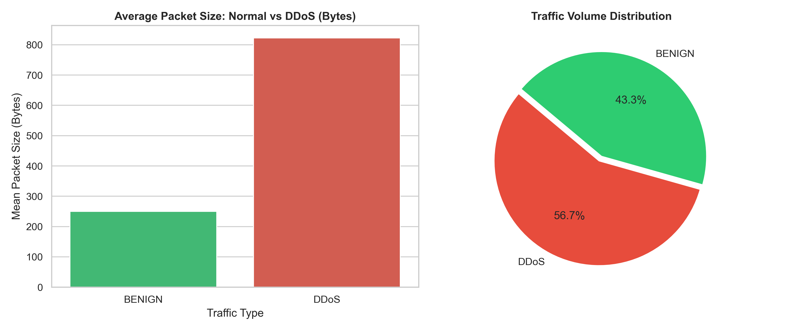

# SOC Threat Intelligence & Network Traffic Analysis

I built this project to analyze network flow anomalies and differentiate DDoS attack patterns from legitimate traffic using the **CICIDS2017** dataset. It combines a local SQLite database, Python for anomaly visualization, and custom DAX measures designed for SOC monitoring dashboards.

## Why This Project?
While studying cybersecurity analytics and threat monitoring, I wanted a hands-on project that moves beyond basic CSV filtering. The goal was simple: take raw packet-level connection logs, structure them efficiently in SQL, and identify the exact metrics (like packet size and flow duration differences) that trigger DDoS alarms in a SOC environment.

## Key Findings & Telemetry
Here is the baseline comparison generated directly from the local SQLite database:



* **Packet Size:** In this dataset, DDoS flows carry larger packets on average (822.6 bytes) than benign flows (249.7 bytes), roughly 3.3x higher.
* **Flow Duration:** The median DDoS flow lasts about 1.88 seconds versus 0.17 seconds for benign traffic. Means are similar (~15.3M vs ~17.0M microseconds), but the medians show that typical benign flows are much shorter, so skewed outliers matter when comparing.
* **Class Balance:** 56.7% of the 225,711 analyzed flows are DDoS and 43.3% are benign. This reflects the dataset sample, not a real-world traffic ratio.

## How It Works
* **Database (`sql/`):** Raw logs are cleaned and ingested into SQLite (`cybersecurity.db`) to simulate connection log indexing.
* **Analysis (`src/visualize.py`):** Queries flow records with Pandas, calculates volume distribution, and plots packet metrics with Seaborn.
* **Power BI & DAX Ready (`docs/`):** Documented analytical DAX formulas (attack ratios, discrepancy indexing) to model these metrics for real-time dashboard reporting.

## How to Run
```bash
# Clone the repository
git clone https://github.com/EylulNur/ai-cybersec-dashboard.git
cd ai-cybersec-dashboard

# Install dependencies
pip install pandas matplotlib seaborn

# Run the visualization pipeline
python3 src/visualize.py
```
The chart is saved to `reports/figures/soc_traffic_overview.png`.
